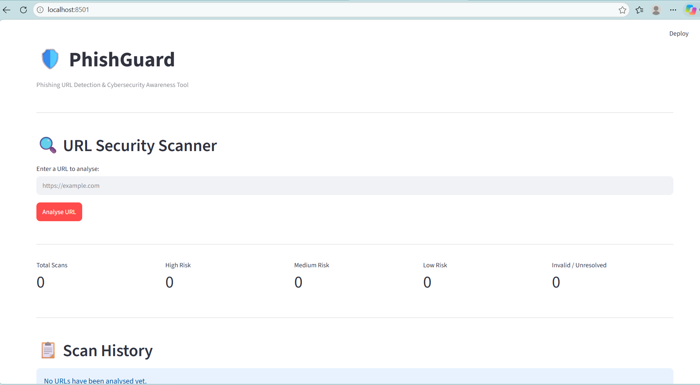
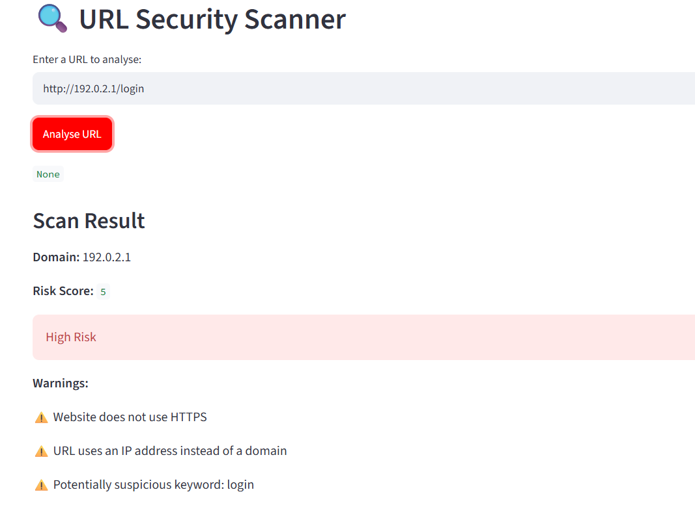
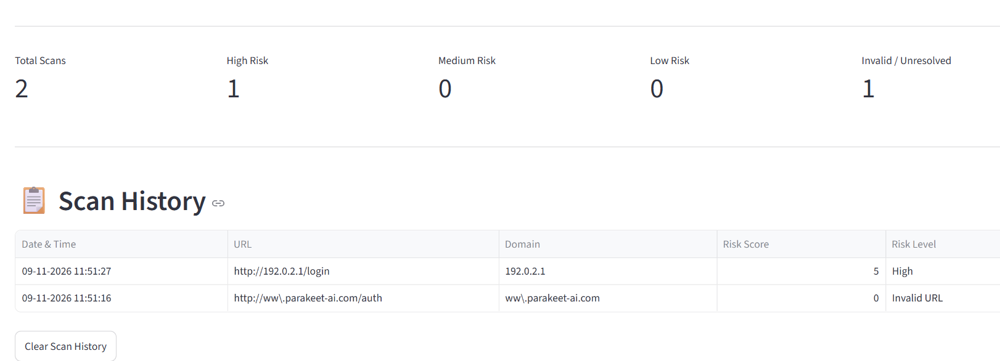

# PhishGuard

A Python-based phishing URL detection and cybersecurity awareness tool built using Streamlit.

PhishGuard analyses URLs using multiple security checks and assigns a risk level to help users identify potentially suspicious websites.

## Application Screenshots

### Dashboard


### URL Scan Result


### Scan History


## Features

- URL format validation
- Domain and DNS resolution checks
- HTTPS security check
- IP address detection
- URL shortener detection
- Suspicious keyword detection
- Risk score calculation
- Low, Medium and High risk classification
- Invalid URL and domain resolution error handling
- Interactive Streamlit dashboard
- Scan history stored using SQLite
- Option to clear scan history

## Technologies Used

| Technology | Purpose |
|---|---|
| Python | Core programming language |
| Streamlit | Web application interface |
| SQLite | Local scan history storage |
| Pandas | Data handling and display |
| Socket | DNS resolution |
| IPaddress | IP address validation |
| Regular Expressions | URL validation |

## Project Structure

```text
Phishgaurd/
│
├── app.py
├── README.md
├── requirements.txt
├── .gitignore
│
└── screenshots/
    ├── Phishgaurd_Dashboard.png
    ├── Phishgaurd_Scan_history.png
    └── Phishgaurd_Url_result.png
```

## Installation and Setup

### 1. Clone the repository

```bash
git clone https://github.com/ZilNagda/PhishGuard.git
```

### 2. Navigate to the project folder

```bash
cd PhishGuard
```

### 3. Create a virtual environment

```bash
python -m venv .venv
```

### 4. Activate the virtual environment

Windows PowerShell:

```powershell
.venv\Scripts\Activate.ps1
```

### 5. Install dependencies

```bash
pip install -r requirements.txt
```

### 6. Run the application

```bash
python -m streamlit run app.py
```

The application will open in your browser.

## How It Works

PhishGuard analyses a submitted URL through several checks:

1. Validates the URL format.
2. Extracts the domain name.
3. Checks whether the domain can be resolved through DNS.
4. Checks for HTTPS usage.
5. Identifies IP-based URLs and URL shorteners.
6. Searches for suspicious keywords.
7. Calculates a risk score based on the detected indicators.
8. Displays the risk classification and stores the scan result in SQLite.

## Risk Classification

| Risk Score | Risk Level |
|---|---|
| 0–1 | Low |
| 2–3 | Medium |
| 4 or above | High |

The score is based on predefined indicators and is not a probability that a URL is malicious.

## Limitations

- Detection is based on heuristic rules rather than a trained machine learning model.
- Legitimate URLs may sometimes be flagged as suspicious.
- New phishing URLs may not always be detected.
- HTTPS does not guarantee that a website is trustworthy.
- DNS resolution only indicates that a domain resolves; it does not establish that the website is safe.

## Future Improvements

- Machine learning-based phishing detection
- Integration with threat intelligence APIs
- Improved URL analysis
- CSV export of scan history
- More advanced security indicators

## Disclaimer

PhishGuard is an educational cybersecurity project developed for learning and awareness purposes. It should not be treated as a replacement for professional security tools.

## Author

**Zil Nagda**

GitHub: https://github.com/ZilNagda